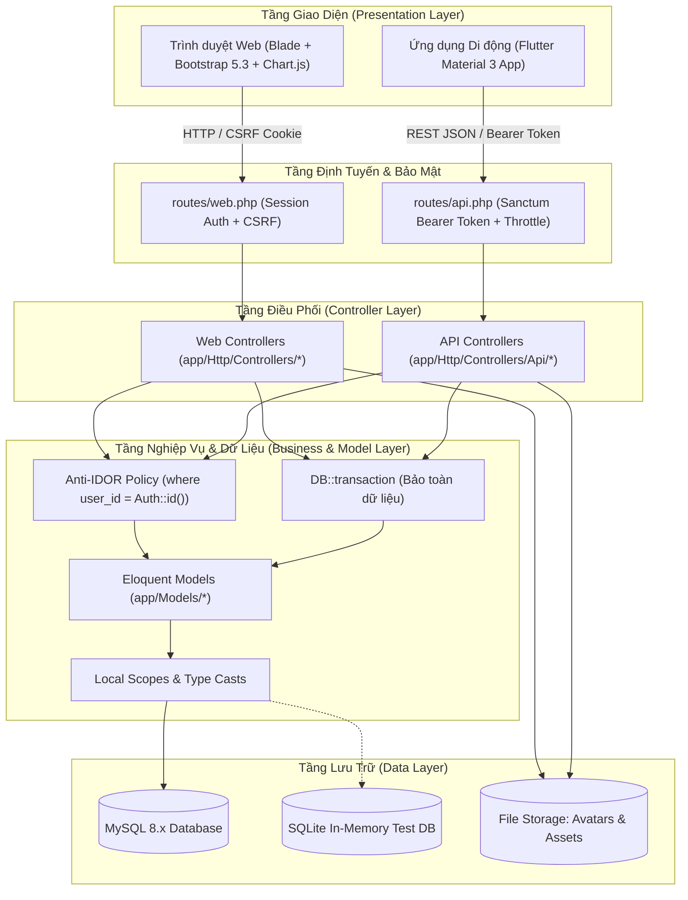
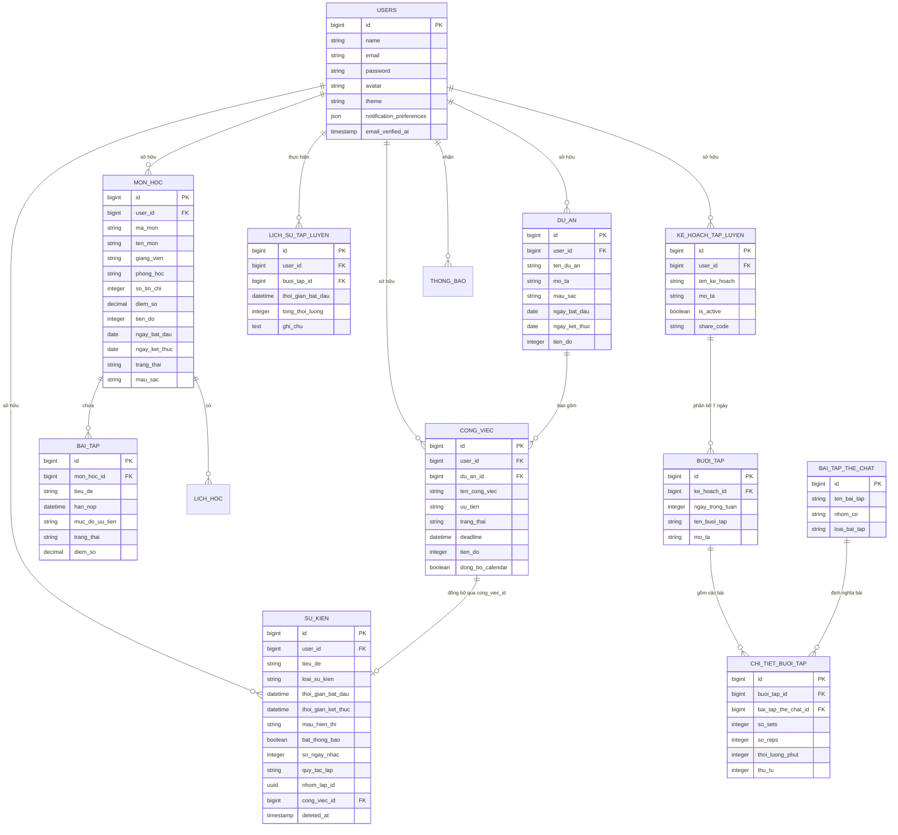

# BÁO CÁO TỔNG QUAN ĐỒ ÁN TỐT NGHIỆP
## HỆ THỐNG QUẢN TRỊ CUỘC SỐNG CÁ NHÂN, HỌC TẬP VÀ RÈN LUYỆN THỂ CHẤT (LIFE PLANNER)
### NỀN TẢNG ĐA PHƯƠNG THỨC: WEB APPLICATION (LARAVEL 13) & MOBILE APPLICATION (FLUTTER)

---

## TÓM TẮT

### Vấn đề được đưa ra giải quyết
* Thiết kế kiến trúc hệ thống và các mô hình dữ liệu cho nền tảng quản trị cuộc sống số toàn diện (All-in-One Life OS) theo triết lý "Calendar First".
* Giải quyết sự phân mảnh công cụ khi người dùng phải dùng nhiều ứng dụng rời rạc cho Lịch biểu, Bài tập/Deadline môn học, Quản lý dự án và Kế hoạch rèn luyện thể thao (Gym/Fitness).
* Xây dựng cơ sở dữ liệu quan hệ hoàn chỉnh (28 migrations, 15 thực thể dữ liệu) xử lý toàn vẹn dữ liệu, chuỗi sự kiện lặp thông minh và cơ chế kiểm soát bảo mật chặt chẽ.
* Xây dựng hệ thống giao tiếp đa nền tảng kết nối đồng bộ giữa Web Application và Mobile Application thông qua hệ sinh thái RESTful API chuẩn mực.

### Mục tiêu đã đạt được
* Xây dựng hoàn chỉnh hệ thống **Life Planner** quản trị cuộc sống cá nhân, học tập và rèn luyện thể chất trên cả nền tảng Web (Laravel 13) và Mobile (Flutter).
* Xây dựng được cơ sở dữ liệu quan hệ hoàn chỉnh (MySQL & SQLite testing), tối ưu hóa liên kết khóa ngoại, cơ chế xóa mềm (Soft Deletes) và bảo toàn giao dịch với Database Transactions.
* Xây dựng hệ thống phân hệ Lịch cá nhân trung tâm thông minh (Calendar First): Lưới tháng 35 ô, phân loại 4 nhóm sự kiện, cơ chế chuỗi lặp UUID linh hoạt (cho phép cập nhật/xóa đơn lẻ hoặc toàn bộ chuỗi).
* Xây dựng phân hệ Quản lý Học tập & Phân tích GPA: Quản lý môn học, bài tập theo mức độ ưu tiên, tự động tính điểm trung bình tích lũy GPA (thang 10 & 4) theo tín chỉ và tự động xếp loại học lực.
* Xây dựng phân hệ Rèn luyện Thể chất & Thể lực: Lịch tập tuần 7 ngày (nhận diện Rest Day), thư viện bài tập theo nhóm cơ, thuật toán tính chuỗi ngày rèn luyện liên tục (Workout Streak), GitHub-style Monthly Heatmap Grid và chia sẻ giáo án qua mã Share Code.
* Xây dựng phân hệ Quản lý Dự án & Công việc cá nhân kèm cơ chế đồng bộ công việc lên Lịch trung tâm một chạm.
* Xây dựng trọn bộ 14 RESTful API Controllers bảo mật bằng Laravel Sanctum Bearer Token, kết nối thông suốt với ứng dụng di động Flutter.
* Xây dựng giao diện người dùng Web hiện đại, responsive, hỗ trợ Dark/Light mode chuẩn xác (tích hợp Anti-Flicker Script) và giao diện Mobile Flutter theo chuẩn Google Material Design 3.

### Kỹ thuật sử dụng
* **Backend:** Sử dụng ngôn ngữ PHP 8.3+, Framework Laravel 13.x (mô hình MVC, Eloquent ORM, Database Migrations, Seeders, Scopes, Model Casts).
* **Xác thực & Bảo mật:** Laravel Breeze (Session Web), Laravel Sanctum (Token-based API), cơ chế bảo mật Anti-IDOR (ràng buộc quyền sở hữu theo `user_id`), Rate Limiting (`throttle:login`).
* **Cơ sở dữ liệu:** Hệ quản trị CSDL quan hệ MySQL (môi trường thực thi chính) và SQLite in-memory (môi trường kiểm thử tự động).
* **Frontend Web:** Laravel Blade Templates, Bootstrap 5.3.3 & Bootstrap Icons, Chart.js, HTML5, CSS3 (CSS Custom Variables, Dark/Light theme), JavaScript ES6+ (AJAX Fetch API).
* **Mobile Application:** Ngôn ngữ Dart, Framework Flutter (SDK >= 3.0.0), Material Design 3, Google Fonts (*Plus Jakarta Sans*).
* **Công cụ phát triển & Kiểm thử:** Xây dựng nhờ vào công cụ Visual Studio Code, môi trường Laragon (PHP 8.3, MySQL, Apache/Nginx), Composer, Vite, PHPUnit 12.x (bộ Feature Tests tự động), Laravel Pint, Postman.

### Kết quả thực hiện
* Hoàn thành đầy đủ 7 phân hệ chức năng: Xác thực & Hồ sơ cá nhân; Lịch trung tâm & Chuỗi lặp sự kiện; Quản lý Học tập & Phân tích GPA; Rèn luyện Thể chất, Streak & Cộng đồng; Quản lý Dự án & Công việc; Hệ thống RESTful API; Ứng dụng Di động Flutter.
* Xây dựng hệ thống báo cáo & trực quan hóa dữ liệu sinh động: Biểu đồ phân tích kết quả học tập và tiến độ môn học, biểu đồ phân bổ nhóm cơ thể chất, biểu đồ nhiệt rèn luyện tháng (Heatmap).
* Đảm bảo chất lượng phần mềm với bộ kiểm thử tự động phong phú (Automated Feature Tests cho Auth, Môn học, Lịch lặp, Tập luyện, Chia sẻ giáo án và 12 tệp kiểm thử API).
* Xuất tài liệu báo cáo kỹ thuật toàn diện, tài liệu đặc tả chức năng và cấu trúc mã nguồn đồ án.

### Kết luận về khóa luận / đồ án
* Hoàn thành xuất sắc đồ án xây dựng hệ thống Life Planner - Nền tảng quản trị cuộc sống số toàn diện (All-in-One Life OS) đáp ứng đầy đủ và vượt mức các mục tiêu, chức năng đã đề ra, vận hành mượt mà trên cả nền tảng Web và Mobile.
* Hệ thống có giá trị ứng dụng thực tiễn cao, giúp người dùng xây dựng lối sống kỷ luật, quản lý thời gian khoa học, đồng thời sở hữu kiến trúc phần mềm chuẩn mực, sẵn sàng tích hợp các công nghệ thông minh (AI, đồng bộ Wearables) trong các giai đoạn phát triển tiếp theo.

---

# LỜI MỞ ĐẦU

Sự bùng nổ mạnh mẽ của thời đại công nghệ số 4.0 và chuyển đổi số đã làm thay đổi sâu sắc phương thức học tập, làm việc cũng như lối sống sinh hoạt của con người, đặc biệt là thế hệ trẻ bao gồm sinh viên các trường đại học và những nhân sự trẻ mới bước chân vào thị trường lao động. Áp lực đa nhiệm (multitasking) ngày càng đè nặng khi mỗi cá nhân phải đối mặt đồng thời với khối lượng môn học đồ sộ theo hệ thống tín chỉ, các bài tập lớn và đồ án có hạn chót dồn dập, các dự án công việc cần duy trì tiến độ, cùng với nhu cầu thiết yếu là rèn luyện thể chất (Gym, Cardio, Thể thao) để duy trì sức khỏe và trạng thái tinh thần minh mẫn.

Tuy nhiên, phần lớn cá nhân hiện nay đang gặp trở ngại lớn trong việc quản trị cuộc sống do sự phân mảnh công cụ: phải dùng một ứng dụng lịch riêng để xem ngày giờ, một ứng dụng ghi chú rời rạc cho bài tập, một file Excel tính điểm trung bình tích lũy GPA cồng kềnh và một ứng dụng gym độc lập để đếm số hiệp bài tập. Việc thiếu vắng một trục dữ liệu thời gian thống nhất khiến người dùng dễ rơi vào tình trạng trễ hạn deadline, đứt gãy chuỗi ngày rèn luyện thể thao, và nghiêm trọng hơn là rơi vào hội chứng quá tải tâm lý (burnout). Khi đó, để vận hành cuộc sống một cách cân bằng và kỷ luật, cần có sự quản lý khoa học được hỗ trợ bởi một nền tảng quản trị cuộc sống số toàn diện (All-in-One Life OS) vận hành theo triết lý **"Calendar First"** — lấy thời gian làm trục tọa độ trung tâm kết nối mọi mục tiêu.

Chính vì thế mà tôi đã lựa chọn đề tài: **“Xây dựng hệ thống quản trị cuộc sống cá nhân, học tập và rèn luyện thể chất (Life Planner)”**, kết hợp sức mạnh kiến trúc backend của **Laravel 13** và giao diện hiện đại đa nền tảng của **Flutter**. Đề tài hy vọng sẽ đem lại một giải pháp toàn diện cho người dùng để quản lý một cách trực quan về thời gian biểu, kiểm soát kết quả học tập và GPA tự động, thiết lập giáo án thể chất và duy trì chuỗi ngày rèn luyện (Streak), cũng như đồng bộ hóa công việc lên lịch một chạm. Với sự hướng dẫn tận tình của Quý Thầy/Cô - Giảng viên tại trường Đại học đã giúp tôi xây dựng hệ thống và hoàn thành đồ án tốt nghiệp này.

---

### 1. Tính cấp thiết của đề tài
Trong bối cảnh xã hội hiện đại, kỹ năng tự quản lý bản thân (Self-Management) và tính kỷ luật cá nhân là yếu tố quyết định sự thành công của sinh viên và người đi làm. Tại các trường đại học ở Việt Nam, hình thức đào tạo theo học chế tín chỉ đòi hỏi sinh viên phải chủ động hoàn toàn trong việc đăng ký môn học, theo dõi tiến độ, tự tính điểm trung bình tích lũy GPA trên cả thang điểm 10 và thang điểm 4. Việc thiếu một công cụ hỗ trợ tính toán tự động và cảnh báo sớm nguy cơ học vụ khiến nhiều sinh viên gặp khó khăn trong việc định hướng kết quả học tập.

Song song đó, phong trào tập gym và rèn luyện thể hình đang ngày càng nở rộ trong giới trẻ, nhưng tỷ lệ người bỏ cuộc sau 1–2 tuần đầu tiên là rất cao do thiếu một kế hoạch tập luyện cụ thể theo ngày, không theo dõi được chuỗi ngày rèn luyện liên tục (Workout Streak) và không có biểu đồ trực quan hóa sự tiến bộ. Mặc dù trên thị trường quốc tế có những ứng dụng như Notion, Google Calendar, Todoist hay Hevy, nhưng chúng bộc lộ nhược điểm là quá phức tạp, giao diện tiếng Anh, thiếu tính liên kết dữ liệu giữa học tập và tập luyện, cũng như không phù hợp với chuẩn đào tạo tín chỉ tại Việt Nam.

Thay vào đó, một hệ thống tích hợp "Tất cả trong một" (All-in-One Life OS) quy tụ toàn bộ lịch trình, deadline môn học, tiến độ công việc và giáo án thể thao về một giao diện duy nhất sẽ giúp tiết kiệm tối đa thời gian, loại bỏ cảm giác phân tâm và nâng cao năng suất sống vượt bậc. Do đó, việc nghiên cứu và thực hiện đề tài **“Xây dựng hệ thống quản trị cuộc sống cá nhân, học tập và rèn luyện thể chất (Life Planner)”** là vô cùng cấp thiết và có ý nghĩa thực tiễn to lớn.

---

### 2. Mục tiêu nghiên cứu của đề tài
Đề tài nghiên cứu hướng đến các mục tiêu trọng tâm sau:
1. **Về giải pháp ứng dụng:**
   - Xây dựng hoàn chỉnh một hệ sinh thái quản lý cuộc sống đa nền tảng bao gồm Web Application và Mobile Application đáp ứng toàn diện 3 trụ cột thiết yếu: **Thời gian** (Lịch biểu trung tâm & Chuỗi lặp sự kiện), **Trí tuệ** (Môn học, Deadline bài tập, Tính điểm GPA, Dự án & Công việc) và **Thể chất** (Giáo án gym 7 ngày, Thư viện bài tập, Chuỗi rèn luyện Streak, Bản đồ nhiệt Heatmap và Chia sẻ giáo án cộng đồng).
   - Đảm bảo trải nghiệm người dùng hiện đại, tốc độ phản hồi nhanh, hỗ trợ chuyển đổi Dark/Light mode không giật nháy (Anti-Flicker) và giao diện di động chuẩn Google Material Design 3.
2. **Về công nghệ và kỹ thuật phần mềm:**
   - Xây dựng cơ sở dữ liệu quan hệ chuẩn hóa cao (28 migrations, 15 thực thể), xử lý toàn vẹn dữ liệu đa bảng thông qua Database Transactions, bảo vệ an toàn dữ liệu với Soft Deletes.
   - Xây dựng hệ thống 14 RESTful API Controllers chuẩn mực bảo mật bằng Laravel Sanctum Bearer Token, làm cầu nối đồng bộ thời gian thực giữa Web và Mobile.
   - Nâng cao năng lực chuyên môn: Làm chủ ngôn ngữ PHP 8.3+, Framework Laravel 13.x, kiến trúc MVC mở rộng kết hợp REST Resource, ngôn ngữ Dart và Framework Flutter (SDK >= 3.0.0), Bootstrap 5.3, Chart.js, Vanilla CSS/JS AJAX, và quy trình kiểm thử tự động Automated Testing với PHPUnit.

---

### 3. Đối tượng và phạm vi nghiên cứu

#### Đối tượng nghiên cứu đề tài
- Quy trình quản lý thời gian biểu cá nhân theo triết lý "Calendar First".
- Phương pháp quản lý học tập tín chỉ, công thức tính điểm trung bình tích lũy GPA có trọng số theo tín chỉ (thang 10 và thang 4) và chuẩn xếp loại học lực tại các trường đại học Việt Nam.
- Phương pháp thiết kế giáo án rèn luyện thể chất theo tuần (PPL - Push/Pull/Legs, Upper/Lower, Cardio), cơ chế ghi nhận nhật ký và thuật toán đếm chuỗi kỷ luật liên tục (Streak Tracking).
- Kiến trúc phần mềm kết hợp giữa Web Application (Laravel) và Mobile Application (Flutter) qua giao thức RESTful API.

#### Phạm vi nghiên cứu đề tài
* **Về phân tích và thiết kế hệ thống:**
  - Thiết kế kiến trúc phân tầng Extended MVC kết hợp RESTful Resource API Service.
  - Thiết kế và chuẩn hóa mô hình dữ liệu quan hệ gồm 15 thực thể Eloquent Models.
  - Thiết lập chính sách bảo mật chống truy cập trái phép IDOR (Insecure Direct Object Reference) và Rate Limiting phòng chống Brute-force.
* **Về các chức năng chi tiết:**
  - **Phân hệ 1: Xác thực & Quản lý Hồ sơ cá nhân (Auth & User Profile):**
    - Đăng ký tài khoản, đăng nhập với tính năng ghi nhớ phiên (`remember_token`).
    - Quên mật khẩu & gửi liên kết đặt lại mật khẩu an toàn qua email.
    - Xác thực email (`MustVerifyEmail`), xác nhận mật khẩu cho các thao tác bảo mật cao.
    - Cập nhật thông tin cá nhân, thay đổi mật khẩu đăng nhập, xóa tài khoản vĩnh viễn.
    - Tải lên ảnh đại diện cá nhân (Avatar JPG, PNG, WEBP $\le$ 2MB), cơ chế tự động xóa ảnh cũ và Smart Fallback trích xuất chữ cái đầu hiển thị khi chưa có ảnh.
    - Chuyển đổi giao diện Sáng / Tối (Dark / Light / System Mode) lưu cấu hình qua AJAX và LocalStorage, tích hợp kịch bản Anti-Flicker ngăn chặn chớp nháy màn hình.
    - Cài đặt tùy chọn thông báo (công tắc tổng Master Switch, thông báo lịch học, deadline, tập luyện và âm thanh thông báo).
  - **Phân hệ 2: Lịch cá nhân trung tâm & Chuỗi lặp sự kiện (Calendar First):**
    - Lưới lịch tháng 35 ô tương tác cao, làm nổi bật trực quan ngày hiện tại ("Hôm nay").
    - Phân loại màu sắc nhận diện tức thì cho 4 nhóm sự kiện: Học tập (`hoc-tap`), Tập luyện (`tap-luyen`), Deadline (`deadline`), Sự kiện cá nhân (`ca-nhan`).
    - Modal thêm mới sự kiện chia thành 4 tab chuyên biệt với trường nhập liệu tương ứng.
    - Kiểm tra tính hợp lệ về thời gian (thời gian kết thúc phải lớn hơn thời gian bắt đầu).
    - Công cụ lặp sự kiện tự động theo chuỗi: Hằng ngày (`daily` - tạo 30 ngày), Hằng tuần (`weekly` - tạo 12 tuần), Hằng tháng (`monthly` - tạo 6 tháng) hoặc Đơn lẻ (`once`), gom nhóm bằng UUID `nhom_lap_id`.
    - Cơ chế cập nhật và xóa sự kiện linh hoạt: Chế độ chỉ sửa/xóa buổi hiện tại (`single`) hoặc sửa/xóa toàn bộ chuỗi lặp (`all`).
    - Cài đặt nhắc nhở trước 1 ngày hoặc 2 ngày, tích hợp Eloquent Query Scope `canNhacThongBao`.
    - Sidebar tóm tắt nhanh (25% màn hình): Lịch trình hôm nay, danh sách sắp đến hạn với badge đếm ngược số ngày, KPI tổng quan trong tuần.
  - **Phân hệ 3: Quản lý Học tập & Phân tích GPA (Study & Academics):**
    - Quản lý danh mục môn học (CRUD): Mã môn, tên môn, giảng viên, phòng học, số tín chỉ (1 - 20), màu sắc đại diện, thanh tiến độ học tập (0 - 100%), điểm số thang 10.
    - Bộ lọc chuẩn hóa ngày tháng `normalizeDate` tự động chuyển đổi linh hoạt giữa định dạng Việt Nam (`dd/mm/yyyy`) và chuẩn ISO (`yyyy-mm-dd`).
    - Quản lý danh mục bài tập & deadline môn học theo 3 mức độ ưu tiên: Cao, Trung bình, Thấp.
    - Thuật toán tính toán GPA tự động: Tính điểm trung bình tích lũy có trọng số tín chỉ trên thang điểm 10 (`GPA10`) và thang điểm 4 (`GPA4`).
    - Tự động xếp loại học lực học thuật: Xuất sắc ($\ge 3.6$), Giỏi ($\ge 3.2$), Khá ($\ge 2.5$), Trung bình ($\ge 2.0$), Yếu/Kém ($< 2.0$).
    - Báo cáo trực quan hóa điểm số và tiến độ hoàn thành môn học bằng thư viện Chart.js.
    - Danh mục cố vấn và gia sư học tập hỗ trợ người dùng theo từng chuyên ngành.
  - **Phân hệ 4: Rèn luyện Thể chất & Thể lực (Workout & Fitness Streak):**
    - Quản lý kế hoạch tập luyện tuần (Workout Plans: PPL, Upper/Lower, Cardio...), kích hoạt kế hoạch đang theo đuổi.
    - Lịch tập 7 ngày trong tuần theo chuẩn ISO-8601 (T2 - CN), tự động nhận diện ngày nghỉ phục hồi (Rest Day).
    - Thư viện danh mục bài tập thể chất (`bai_tap_the_chat`) phân loại theo nhóm Sức mạnh, Tim mạch, Trọng tâm; quản lý thông số Sets, Reps, Thời lượng.
    - Ghi nhận lịch sử tập luyện và thuật toán tính chuỗi ngày rèn luyện liên tục (Workout Streak Tracking).
    - Bản đồ nhiệt hoạt động theo tháng (Monthly Heatmap Grid) 4 cấp độ màu tương tự GitHub Contribution Graph.
    - Biểu đồ tròn phân bổ tỷ lệ nhóm cơ (Push, Pull, Legs, Cardio) và biểu đồ tần suất tập theo ngày.
    - Tính năng chia sẻ giáo án rèn luyện cộng đồng qua mã `share_code` ngẫu nhiên và chức năng sao chép giáo án 1 chạm.
    - Checklist tập luyện trong ngày tiện lợi khi thao tác tại phòng tập.
  - **Phân hệ 5: Quản lý Dự án & Công việc (Projects & Tasks Management):**
    - Quản lý dự án tổng thể (`du_an`), gán màu nhận diện, mục tiêu, ngày bắt đầu/kết thúc và thanh tiến độ tổng.
    - Quản lý công việc chi tiết (`cong_viec`), phân loại ưu tiên, cập nhật trạng thái nhanh (Chưa bắt đầu, Đang làm, Hoàn thành), thanh kéo tiến độ 0 - 100%.
    - Tự động gắn cờ cảnh báo công việc quá hạn (`is_qua_han`, `qua_han_text`).
    - Cơ chế đồng bộ công việc lên Lịch trung tâm (`syncToCalendar`) thông qua liên kết khóa ngoại `cong_viec_id`.
  - **Phân hệ 6: Hệ thống RESTful API toàn diện:**
    - Xây dựng 14 API Controllers với đầy đủ endpoint CRUD chuẩn mực tại tiền tố `/api/*`.
    - Bảo vệ các tuyến đường riêng tư bằng middleware xác thực `auth:sanctum` với Bearer Token.
    - Chuẩn hóa cấu trúc phản hồi dữ liệu JSON nhất quán cho ứng dụng di động và các hệ thống bên ngoài.
  - **Phân hệ 7: Ứng dụng Di động Flutter (Mobile Companion):**
    - Xây dựng giao diện chuẩn Material Design 3, Typography Google Fonts Plus Jakarta Sans.
    - Màn hình Dashboard với thanh lịch tuần cuộn ngang 7 ngày (Weekly Calendar Selector).
    - Thẻ hành động tiếp theo (Next Action Card) làm nổi bật sự kiện hoặc bài tập quan trọng nhất sắp diễn ra.
    - Thanh Filter Chips phân loại sự kiện tức thì.
    - Thẻ danh sách sự kiện (Event Card) hiển thị chi tiết thời gian, địa điểm, trạng thái.
    - Thẻ gợi ý thông minh (AI Insight Card) hiển thị thông điệp động viên và thói quen sinh hoạt.
    - Thanh điều hướng chân trang (Bottom Navigation Bar) gồm 4 mục: Trang chủ, Lịch, Học tập, Thể chất.

---

### 4. Phương pháp nghiên cứu

#### Về lý thuyết
* Tìm hiểu và nghiên cứu phương pháp quản trị thời gian khoa học (Time Blocking, Calendar-First Approach).
* Nghiên cứu quy chế đào tạo đại học theo hệ thống tín chỉ, công thức tính điểm trung bình tích lũy GPA và các tiêu chuẩn xếp loại học lực tại Việt Nam.
* Nghiên cứu các phương pháp phân chia giáo án thể hình khoa học (Push/Pull/Legs, Upper/Lower, Full Body) và tâm lý học hành vi trong việc duy trì chuỗi kỷ luật (Streak / Gamification).
* Nghiên cứu ngôn ngữ lập trình PHP 8.3 và Framework Laravel 13.x: Kiến trúc MVC, Eloquent ORM, Database Migrations, Seeder, Scopes, Casts, Middleware.
* Nghiên cứu hệ quản trị cơ sở dữ liệu quan hệ MySQL, kỹ thuật thiết kế chuẩn hóa và nguyên lý bảo đảm toàn vẹn giao dịch ACID (Database Transactions).
* Nghiên cứu ngôn ngữ Dart và Framework Flutter (SDK >= 3.0.0), mô hình kiến trúc phân tầng (Layered Architecture) và ngôn ngữ thiết kế Material 3.
* Nghiên cứu các tiêu chuẩn bảo mật ứng dụng web và API: Laravel Sanctum, phòng chống lỗ hổng IDOR, CSRF, XSS, SQL Injection và kỹ thuật giới hạn tần suất gọi (Rate Limiting).

#### Về thực nghiệm
* Khảo sát thực tế nhu cầu và hành vi quản lý thời gian, học tập và rèn luyện thể thao của sinh viên và người đi làm trẻ.
* Phân tích yêu cầu bài toán, mô hình hóa các biểu đồ hệ thống (Use Case, Sequence, Sơ đồ quan hệ thực thể ERD).
* Xây dựng cơ sở dữ liệu gồm 28 migration files và 15 Eloquent models với đầy đủ liên kết quan hệ và ràng buộc khóa ngoại.
* Triển khai xây dựng lần lượt các module chức năng theo mức độ ưu tiên: Xác thực & Profile $\rightarrow$ Lịch cá nhân trung tâm $\rightarrow$ Môn học & Báo cáo GPA $\rightarrow$ Rèn luyện Thể chất & Streak $\rightarrow$ Dự án & Công việc $\rightarrow$ Hệ thống RESTful API $\rightarrow$ Ứng dụng Di động Flutter.
* Thực hiện kiểm thử tự động (Automated Testing) với bộ Feature Tests phong phú trong Laravel (PHPUnit 12.x) cho từng phân hệ nghiệp vụ và API endpoint, bảo đảm tính ổn định, độ tin cậy và hiệu năng trước khi đóng gói sản phẩm.

---

### 5. Kết cấu của đề tài
Ngoài phần tóm tắt, lời mở đầu, kết luận và tài liệu tham khảo, nội dung chính của đề tài được kết cấu thành **04 chương**:

* **Chương 1: TỔNG QUAN TÀI LIỆU VÀ CƠ SỞ LÝ THUYẾT**  
  Trình bày bối cảnh thực tế, phân tích vấn đề và hạn chế của các giải pháp hiện tại, khảo sát nhu cầu người dùng, giới thiệu tổng quan các công nghệ chính được sử dụng trong dự án (PHP 8.3, Laravel 13, MySQL, Bootstrap 5.3, Chart.js, Flutter, Material 3, Laravel Sanctum).
* **Chương 2: PHÂN TÍCH VÀ THIẾT KẾ HỆ THỐNG**  
  Trình bày kiến trúc tổng thể của hệ thống Life Planner; mô tả biểu đồ Use Case; thiết kế cơ sở dữ liệu chi tiết (ERD, cấu trúc 28 bảng và 15 Eloquent models); thiết kế kiến trúc bảo mật Anti-IDOR, Soft Deletes, Database Transactions và đặc tả thiết kế hệ sinh thái RESTful API.
* **Chương 3: CÀI ĐẶT THỰC NGHIỆM VÀ KẾT QUẢ ĐẠT ĐƯỢC**  
  Chi tiết quá trình hiện thực hóa các phân hệ chức năng trên nền tảng Web Application và Mobile Application (Flutter); mô tả giao diện người dùng thực tế; trình bày các thuật toán cốt lõi (tính GPA, chuỗi sự kiện lặp UUID, thuật toán đếm streak thể chất); và công tác kiểm thử tự động với bộ Feature Tests (PHPUnit).
* **Chương 4: KẾT LUẬN VÀ HƯỚNG PHÁT TRIỂN**  
  Đánh giá tổng kết các kết quả đạt được so với mục tiêu ban đầu; chỉ ra các điểm mạnh nổi bật và những hạn chế còn tồn tại; đồng thời vạch ra lộ trình phát triển trong tương lai (Cron Job gửi thông báo tự động, tích hợp AI Gemini gợi ý lịch biểu, kết nối thiết bị đeo thông minh Apple Health / Google Fit).

---

# CHƯƠNG 1. TỔNG QUAN TÀI LIỆU

## 1.1. Khảo sát bài toán

### 1.1.1. Đặt vấn đề
Trong kỷ nguyên công nghệ số và chuyển đổi số bùng nổ, con người — đặc biệt là thế hệ học sinh, sinh viên đại học và những nhân sự trẻ mới gia nhập thị trường lao động — đang phải đối mặt với áp lực đa nhiệm (multitasking) ngày càng gia tăng. Sự thay đổi trong phương thức đào tạo và làm việc đòi hỏi mỗi cá nhân phải có năng lực tự quản trị cuộc sống một cách kỷ luật và khoa học. Tuy nhiên, qua khảo sát thực tế, phần lớn người trẻ đang gặp phải những thách thức lớn:

1. **Áp lực học tập theo học chế tín chỉ và quản lý deadline dồn dập:**
   * Tại các trường đại học hiện nay, việc đào tạo theo hệ thống tín chỉ mang lại sự linh hoạt nhưng đồng thời đặt ra thách thức tự chủ rất lớn. Sinh viên phải tự sắp xếp thời khóa biểu với các khung giờ học, giảng đường và giảng viên khác nhau theo từng ngày.
   * Cùng với lịch học trên lớp là hàng loạt bài tập lớn, bài tập nhóm, đồ án môn học và lịch thi cử dày đặc. Việc thiếu một công cụ theo dõi hạn chót trực quan kèm mức độ ưu tiên (Cao, Trung bình, Thấp) khiến tình trạng "nước đến chân mới nhảy", nộp muộn deadline hoặc bỏ sót bài tập diễn ra phổ biến.

2. **Khó khăn và sai lệch trong việc theo dõi điểm số và tính toán GPA:**
   * Mỗi môn học có số lượng tín chỉ khác nhau (từ 1 đến 4 tín chỉ), kết hợp với quy chế đánh giá đa tầng (điểm chuyên cần, điểm kiểm tra giữa kỳ, điểm tiểu luận, điểm thi cuối kỳ trên thang điểm 10) và quy đổi sang điểm chữ (A, B, C, D, F) tương ứng với thang điểm 4.
   * Phần lớn sinh viên hiện nay tự tính điểm GPA tích lũy bằng cách ghi chép sổ tay hoặc dùng file Excel thủ công. Phương pháp này không chỉ tốn thời gian, dễ nhầm lẫn công thức tính trọng số tín chỉ mà còn thiếu tính kịp thời — sinh viên không thể nhìn thấy ngay biến động học lực để có kế hoạch cải thiện điểm số trước khi quá muộn.

3. **Thách thức trong việc duy trì thói quen rèn luyện thể chất và thể lực:**
   * Nhu cầu tập gym, rèn luyện thể hình và thể thao để nâng cao sức khỏe và giải tỏa căng thẳng sau giờ học/làm việc là rất lớn. Tuy nhiên, theo các khảo sát về hành vi, có tới hơn 65% người mới bắt đầu tập luyện từ bỏ sau 2–3 tuần đầu tiên.
   * Nguyên nhân chính là do thiếu một kế hoạch tập luyện cụ thể theo ngày trong tuần (giáo án phân chia nhóm cơ khoa học như Push/Pull/Legs hay Upper/Lower), thiếu công cụ ghi chép nhanh số hiệp (sets) và số lần lặp (reps), và đặc biệt là thiếu một cơ chế tâm lý ghi nhận chuỗi ngày rèn luyện liên tục (Workout Streak) để duy trì động lực bền bỉ.

4. **Quản lý dự án cá nhân và công việc ngoài giờ học:**
   * Bên cạnh học tập và thể thao, sinh viên và người trẻ thường tham gia các dự án nghiên cứu khoa học, hoạt động câu lạc bộ, đồ án tốt nghiệp hoặc công việc làm thêm (part-time, freelance).
   * Các công việc này thường phát sinh ngẫu nhiên, không được đồng bộ hóa với thời khóa biểu, dẫn đến hiện tượng xung đột thời gian (trùng lịch học với lịch họp dự án hoặc lịch tập gym).

5. **Hiện tượng phân mảnh công cụ (App Fragmentation & Fatigue):**
   * Để giải quyết các nhu cầu trên, người dùng hiện nay buộc phải sử dụng rời rạc 4–5 ứng dụng độc lập:
     - *Google Calendar / Apple Calendar:* Chỉ quản lý ngày giờ đơn thuần, không gắn liền với môn học tín chỉ hay bài tập.
     - *Notion / Todoist / Trello:* Mạnh về ghi chú nhưng cấu hình quá phức tạp, độ dốc học tập cao, không được địa phương hóa cho đào tạo tín chỉ tại Việt Nam.
     - *File bảng tính Excel / Google Sheets:* Dễ tính toán nhưng giao diện thô cứng, khó dùng trên điện thoại di động, không có thông báo hay tự động hóa.
     - *Ứng dụng thể hình (Hevy, Strong):* Ghi chép bài tập tốt nhưng hoàn toàn tách biệt với lịch học và công việc cá nhân.
   * Sự thiếu vắng một trục dữ liệu liên kết khiến người dùng tốn nhiều công sức nhập liệu lặp lại, thường xuyên bỏ quên thông tin và dễ rơi vào trạng thái quá tải tâm lý (burnout).

### 1.1.2. Giải pháp
Tôi đã đưa ra giải pháp là xây dựng hệ thống quản trị cuộc sống cá nhân, học tập và rèn luyện thể chất (Life Planner) trên nền tảng Web và ứng dụng di động, để mang đến cho người dùng một giải pháp tốt nhất cho việc quản lý thời gian biểu, theo dõi học tập và duy trì kỷ luật rèn luyện thể chất một cách khoa học và thiết thực.

### 1.1.3. Mục đích của đề tài
Đề tài được thực hiện nhằm hướng đến các mục đích cụ thể sau:

1. **Mục đích thực tiễn đối với người sử dụng:**
   * **Tối ưu hóa thời gian và nâng cao năng suất:** Giúp sinh viên và người đi làm tiết kiệm thời gian, loại bỏ hoàn toàn sự phân mảnh công cụ, gom toàn bộ lịch trình, học tập và rèn luyện thể chất vào một nền tảng duy nhất.
   * **Kiểm soát và nâng cao kết quả học tập:** Cung cấp bức tranh toàn cảnh về tiến độ tín chỉ, tự động hóa tính điểm GPA và xếp loại học lực, giúp người học phát hiện sớm rủi ro học thuật và kịp thời điều chỉnh phương pháp học tập.
   * **Xây dựng lối sống kỷ luật và thói quen rèn luyện bền vững:** Duy trì thói quen tập luyện thể dục thể thao đều đặn thông qua thuật toán chuỗi ngày rèn luyện (Streak) và biểu đồ nhiệt (Heatmap), đồng thời thúc đẩy văn hóa chia sẻ giáo án tập luyện lành mạnh trong cộng đồng.
   * **Trải nghiệm sử dụng linh hoạt mọi lúc mọi nơi:** Cho phép người dùng quản trị chuyên sâu trên máy tính qua Web Dashboard và cập nhật nhanh trạng thái trong ngày trên điện thoại di động qua ứng dụng Flutter.

2. **Mục đích học thuật và phát triển chuyên môn phần mềm:**
   * **Nghiên cứu và làm chủ công nghệ hiện đại:** Vận dụng sâu sắc ngôn ngữ PHP 8.3+, Framework Laravel 13.x, ngôn ngữ Dart và Framework Flutter đa nền tảng (SDK >= 3.0.0).
   * **Thiết kế kiến trúc phần mềm chuẩn mực:** Hiện thực hóa mô hình kiến trúc phân tầng kết hợp giữa Extended MVC cho Web và RESTful Resource Service cho Mobile, tuân thủ các nguyên lý SOLID và DRY.
   * **Thiết kế cơ sở dữ liệu quan hệ hoàn chỉnh:** Xây dựng cơ sở dữ liệu gồm 28 migration files và 15 Eloquent models, tối ưu hóa quan hệ khóa ngoại, cơ chế xóa mềm (Soft Deletes) và bảo toàn giao dịch dữ liệu đa bảng bằng Database Transactions.
   * **Nâng cao năng lực bảo mật ứng dụng:** Áp dụng triệt để cơ chế chống lỗi kiểm soát truy cập trực tiếp IDOR (Insecure Direct Object Reference), xác thực kép Session & Sanctum Bearer Token, phòng chống tấn công CSRF, XSS, SQL Injection và kỹ thuật giới hạn tần suất gọi API (Rate Limiting).
   * **Rèn luyện quy trình kiểm thử tự động (Automated Testing):** Xây dựng bộ Feature Tests hoàn chỉnh trên PHPUnit 12.x với môi trường in-memory SQLite, bảo đảm độ tin cậy và chất lượng phần mềm đạt chuẩn trước khi phát hành.

## 1.2. Cơ sở lý thuyết và Công nghệ sử dụng

```
+-----------------------------------------------------------------------------------+
|                           HỆ THỐNG CÔNG NGHỆ ÁP DỤNG                              |
+--------------------------+----------------------------+---------------------------+
|    BACKEND & SECURITY    |       FRONTEND WEB         |      MOBILE FLUTTER       |
+--------------------------+----------------------------+---------------------------+
| • PHP 8.3+               | • Laravel Blade Templates  | • Dart SDK >= 3.0.0       |
| • Laravel 13.x Framework | • Bootstrap 5.3.3 & Icons  | • Flutter SDK             |
| • MySQL 8.x Relational   | • Chart.js Interactive     | • Material Design 3       |
| • SQLite In-Memory Test  | • Vanilla CSS Module hóa   | • Google Fonts Jakarta    |
| • Laravel Sanctum Auth   | • Modern JavaScript AJAX   | • Layered Architecture    |
| • Anti-IDOR Policy       | • Anti-Flicker Dark Mode   | • Responsive Dashboard    |
+--------------------------+----------------------------+---------------------------+
```

### 1.3.1. Ngôn ngữ PHP 8.3 và Framework Laravel 13
* **PHP 8.3:** Phiên bản PHP hiện đại với hiệu năng thực thi vượt trội thông qua JIT Compiler, hỗ trợ *Constructor Property Promotion*, *Match Expressions*, *Typed Class Constants* và hệ thống kiểu dữ liệu nghiêm ngặt (*Strict Typing*).
* **Laravel 13.x:** Khung phát triển ứng dụng PHP mã nguồn mở mạnh mẽ nhất hiện nay, cung cấp:
  - Hệ thống định tuyến mạnh mẽ (Routing Engine) hỗ trợ phân nhóm route, tiền tố và middleware.
  - Eloquent ORM: Mô hình hóa cơ sở dữ liệu hướng đối tượng trực quan, hỗ trợ quan hệ 1-N, N-N, Eager Loading ngăn chặn triệt để lỗi truy vấn $N+1$.
  - Database Migrations & Seeders: Quản lý phiên bản CSDL bằng mã nguồn, cho phép tái lập môi trường đồng nhất.
  - Cơ chế Database Transactions: Đảm bảo tính toàn vẹn ACID khi thao tác dữ liệu phức tạp trên nhiều bảng.

### 1.3.2. Cơ sở dữ liệu quan hệ MySQL & SQLite
* **MySQL 8.x:** Hệ quản trị CSDL quan hệ chính cho môi trường vận hành thực tế, hỗ trợ khóa ngoại (Foreign Keys), ràng buộc toàn vẹn tham chiếu và lập chỉ mục (Indexes) tối ưu hóa tốc độ truy vấn.
* **SQLite In-Memory:** Được cấu hình chuyên biệt cho môi trường kiểm thử tự động trong `phpunit.xml`, giúp toàn bộ các bài Feature Tests chạy trực tiếp trên RAM với tốc độ siêu tốc mà không làm thay đổi dữ liệu thật.

### 1.3.3. Cơ chế Xác thực và Bảo mật kép
* **Laravel Breeze (Session Web):** Xác thực người dùng phía Web dựa trên Cookie mã hóa an toàn, tích hợp sẵn cơ chế chống tấn công giả mạo yêu cầu chéo CSRF (`@csrf`).
* **Laravel Sanctum (Token-Based API):** Cơ chế cấp phát mã thông báo Bearer Token có thời hạn cho ứng dụng di động Flutter và các giao thức REST API, cho phép xác thực không lưu trạng thái (Stateless Authentication).
* **Kiến trúc bảo mật Anti-IDOR (Insecure Direct Object Reference):** Mọi thao tác truy vấn dữ liệu từ Controller đều được ràng buộc điều kiện quyền sở hữu `where('user_id', Auth::id())`, triệt tiêu hoàn toàn khả năng người dùng can thiệp vào tài nguyên của người khác.

### 1.3.4. Frontend Web Application: Blade, Bootstrap 5.3 và Chart.js
* **Blade Template Engine:** Công nghệ biên dịch giao diện có sẵn của Laravel, cho phép kế thừa layout nhiều tầng (`layouts/app.blade.php`), nhúng các component dùng chung và tự động mã hóa ký tự đặc biệt phòng chống tấn công XSS.
* **Bootstrap 5.3.3 & Bootstrap Icons:** Thư viện giao diện chuẩn quốc tế, cung cấp hệ thống Responsive Grid, Offcanvas Sidebar, Modal dialog và hỗ trợ đổi màu chủ đề Dark/Light linh hoạt.
* **Chart.js:** Thư viện trực quan hóa dữ liệu bằng biểu đồ HTML5 Canvas, hiển thị trực quan biểu đồ tiến độ môn học, phân bổ GPA và tỷ lệ các nhóm cơ rèn luyện thể chất.

### 1.3.5. Ứng dụng Di động Flutter và Ngôn ngữ Dart
* **Flutter SDK & Dart 3.x:** Bộ công cụ phát triển phần mềm giao diện di động đa nền tảng của Google, biên dịch mã nguồn trực tiếp ra mã máy Native (ARM/x86), mang lại hiệu năng 60fps mượt mà.
* **Material Design 3:** Ngôn ngữ thiết kế giao diện hiện đại nhất của Google, hỗ trợ bảng màu linh hoạt, góc bo mềm mại, hiệu ứng đổ bóng Card Elevation và trải nghiệm chạm thân thiện.

---

# CHƯƠNG 2: PHÂN TÍCH VÀ THIẾT KẾ HỆ THỐNG

## 2.1. Kiến trúc tổng thể hệ thống

Hệ thống được thiết kế theo mô hình kiến trúc phân tầng kết hợp giữa **Extended MVC** cho Web và **RESTful Resource API Service** cho ứng dụng Mobile:



## 2.2. Phân tích chức năng hệ thống (Use Case)

Hệ thống phục vụ người dùng cá nhân với các nhóm chức năng chính:
1. **Nhóm Xác thực & Hồ sơ:** Đăng ký, Đăng nhập, Đổi mật khẩu, Quên mật khẩu, Cập nhật thông tin, Tải lên ảnh đại diện, Chuyển đổi Dark/Light mode, Cài đặt thông báo.
2. **Nhóm Lịch trung tâm:** Xem lịch tháng 35 ô, Lọc theo 4 loại sự kiện, Tạo sự kiện đơn lẻ hoặc chuỗi lặp (Daily/Weekly/Monthly), Chỉnh sửa/xóa sự kiện (chế độ single/all), Xem tóm tắt lịch trình hôm nay và danh sách sắp đến hạn.
3. **Nhóm Học tập & GPA:** Quản lý môn học, Cập nhật điểm và tiến độ, Quản lý bài tập theo độ ưu tiên, Tính toán GPA thang 10 & 4, Xếp loại học lực, Xem biểu đồ học tập, Danh mục gia sư.
4. **Nhóm Thể chất & Gym:** Quản lý kế hoạch tập luyện tuần, Cấu hình buổi tập 7 ngày, Quản lý thư viện bài tập theo hiệp/lặp, Ghi nhận hoàn thành buổi tập, Đếm chuỗi ngày rèn luyện liên tục (Streak), Xem bản đồ nhiệt tháng (Heatmap), Chia sẻ và sao chép giáo án cộng đồng qua mã Share Code.
5. **Nhóm Dự án & Công việc:** Quản lý dự án tổng thể, Quản lý công việc chi tiết, Kéo thanh trượt tiến độ %, Cảnh báo công việc quá hạn, Đồng bộ công việc lên Lịch trung tâm một chạm.
6. **Nhóm Di động & API:** Đăng nhập lấy Bearer Token, Truy xuất dữ liệu Dashboard tổng hợp, Tương tác với lịch tuần cuộn ngang, Nhận thông báo và gợi ý AI Insight.

## 2.3. Thiết kế Cơ sở dữ liệu quan hệ (Database Design)

Hệ thống sở hữu cơ sở dữ liệu gồm **28 migration files** ánh xạ tới **15 Eloquent Models** có cấu trúc quan hệ chặt chẽ:



## 2.4. Thiết kế Kiến trúc Bảo mật & Toàn vẹn Dữ liệu

### 2.4.1. Cơ chế chống lỗi kiểm soát truy cập trực tiếp IDOR
Toàn bộ logic truy vấn tại tất cả các Controllers đều tuân thủ nguyên tắc ràng buộc kép:
```php
// Ví dụ xử lý chuẩn trong MonHocController và SuKienController:
$userId = Auth::id();

// Tìm kiếm bản ghi kèm kiểm tra quyền sở hữu tuyệt đối:
$monHoc = MonHoc::where('user_id', $userId)->findOrFail($id);
$suKien = SuKien::where('user_id', $userId)->findOrFail($id);
```
Ngay cả với thao tác xóa sự kiện lặp theo chuỗi `nhom_lap_id`, hệ thống luôn gán điều kiện `user_id = $userId`:
```php
SuKien::where('user_id', $userId)->where('nhom_lap_id', $nhomLapId)->delete();
```
Nhờ đó, người dùng hoàn toàn không thể xem, sửa hoặc xóa dữ liệu của người khác cho dù biết trước ID của đối tượng.

### 2.4.2. Bảo toàn giao dịch dữ liệu đa bảng với Database Transactions
Khi thực thi các hành động ghi phức tạp liên quan đến nhiều bảng dữ liệu đồng thời, toàn bộ câu lệnh đều được bao bọc trong `DB::transaction()`:
1. **Khởi tạo sự kiện lặp:** Tạo UUID nhóm, lặp ngày tháng (Daily: 30 ngày, Weekly: 12 tuần, Monthly: 6 tháng) và ghi hàng loạt bản ghi con. Nếu xảy ra lỗi giữa chừng, toàn bộ thay đổi sẽ được hoàn tác (Rollback).
2. **Cập nhật danh sách bài tập cho buổi tập:** Xóa chi tiết bài tập cũ và ghi danh sách bài tập mới kèm thứ tự trong một khối Transaction duy nhất.
3. **Sao chép kế hoạch rèn luyện cộng đồng:** Nhân bản kế hoạch, các buổi tập trong tuần và toàn bộ chi tiết bài tập sang tài khoản người nhận một cách toàn vẹn.

---

# CHƯƠNG 3: CÀI ĐẶT THỰC NGHIỆM VÀ KẾT QUẢ ĐẠT ĐƯỢC

## 3.1. Hiện thực hóa các phân hệ chức năng trên Web Application

### 3.1.1. Phân hệ Lịch cá nhân trung tâm (Calendar First)
- **Giao diện Lưới tháng 35 ô tương tác:** Được hiện thực hóa tại `resources/views/calendar/index.blade.php`, hỗ trợ chuyển tháng mượt mà qua AJAX, tự động xác định ngày đầu tiên của tháng và vẽ các ô ngày theo đúng thứ trong tuần (Thứ 2 đến Chủ Nhật).
- **Phân loại 4 nhóm sự kiện bằng màu sắc:**
  - 📘 **Lịch học (`hoc-tap`):** Tông màu xanh dương (#3B82F6).
  - 🏋️ **Lịch tập (`tap-luyen`):** Tông màu cam hổ phách (#F59E0B).
  - ⏰ **Deadline (`deadline`):** Tông màu đỏ san hô (#EF4444).
  - 🎉 **Sự kiện cá nhân (`ca-nhan`):** Tông màu tím thạch anh (#8B5CF6).
- **Modal thêm mới 4 Tabs và Quy tắc lặp thông minh:** Cho phép chọn tần suất lặp lại (Hằng ngày, Hằng tuần, Hằng tháng). Hệ thống gán mã UUID `nhom_lap_id` duy nhất cho chuỗi và hỗ trợ tùy chọn sửa/xóa đơn lẻ (`single`) hoặc sửa/xóa toàn bộ chuỗi (`all`).

### 3.1.2. Phân hệ Quản lý Học tập & Thuật toán tính GPA
- **Bộ chuẩn hóa ngày tháng tự động (`normalizeDate`):** Khắc phục lỗi nhập liệu ngày tháng giữa định dạng Việt Nam (`dd/mm/yyyy`) và chuẩn SQL (`yyyy-mm-dd`).
- **Thuật toán tính điểm trung bình tích lũy GPA trọng số:**
  $$\text{GPA}_{10} = \frac{\sum (\text{Điểm môn}_i \times \text{Số tín chỉ}_i)}{\sum \text{Số tín chỉ}_i}$$
- **Quy đổi GPA sang Thang điểm 4 theo chuẩn học thuật:**
  - Điểm $\ge 8.5$: Điểm chữ A (Hệ 4: 4.0)
  - Điểm $\ge 7.0$: Điểm chữ B (Hệ 4: 3.0)
  - Điểm $\ge 5.5$: Điểm chữ C (Hệ 4: 2.0)
  - Điểm $\ge 4.0$: Điểm chữ D (Hệ 4: 1.0)
  - Điểm $< 4.0$: Điểm chữ F (Hệ 4: 0.0)
- **Tự động xếp loại học lực:** Xuất sắc ($\ge 3.6$), Giỏi ($\ge 3.2$), Khá ($\ge 2.5$), Trung bình ($\ge 2.0$), Yếu/Kém ($< 2.0$).
- **Trực quan hóa dữ liệu:** Sử dụng Chart.js vẽ biểu đồ điểm số từng môn và biểu đồ tiến độ học tập.

### 3.1.3. Phân hệ Rèn luyện Thể chất & Thuật toán Đếm chuỗi kỷ luật (Streak)
- **Lịch tập 7 ngày chuẩn ISO:** Phân bổ các buổi tập từ Thứ 2 đến Chủ Nhật. Ngày không có buổi tập được tự động nhận diện là **Ngày Nghỉ (Rest Day)**.
- **Thuật toán đếm chuỗi ngày rèn luyện liên tục (Workout Streak Algorithm):**
  1. Trích xuất danh sách ngày hoàn thành buổi tập từ bảng `lich_su_tap_luyen` của người dùng, lọc duy nhất theo ngày (`unique date`) và sắp xếp giảm dần theo thời gian.
  2. Kiểm tra nếu ngày tập gần nhất là ngày hôm nay hoặc ngày hôm qua:
     - Khởi tạo bộ đếm chuỗi `streak = 0`.
     - Lặp qua các mốc ngày, mỗi bước kiểm tra xem ngày tiếp theo có liền kề ngày trước đó đúng 1 ngày (`subDay()`) hay không.
     - Nếu liên tục, tăng `streak++`; nếu bị ngắt quãng, dừng thuật toán và trả về kết quả chuỗi hiện tại.
- **Bản đồ nhiệt hoạt động theo tháng (Monthly Heatmap Grid):** Trực quan hóa 31 ngày trong tháng với 4 mức độ màu xanh lục từ nhạt đến đậm (Level 0 đến Level 3) tùy theo cường độ rèn luyện trong ngày.
- **Tính năng chia sẻ kế hoạch cộng đồng:** Tạo mã `share_code` 8 ký tự ngẫu nhiên. Người dùng khác chỉ cần nhập mã hoặc truy cập đường dẫn `/workout/share/{code}` là có thể xem trước và sao chép toàn bộ giáo án sang tài khoản của mình.

### 3.1.4. Phân hệ Quản lý Dự án & Công việc cá nhân
- Quản lý dự án tổng thể với màu nhận diện và tỷ lệ hoàn thành tự động tính dựa trên các nhiệm vụ con.
- Quản lý công việc với mức ưu tiên và thanh trượt tiến độ 0% - 100%.
- Cảnh báo công việc quá hạn tự động (`is_qua_han = true` khi deadline đã qua mà trạng thái khác 'hoan_thanh').
- Tính năng **Đồng bộ Lịch một chạm (`syncToCalendar`)**: Tự động tạo bản ghi `su_kien` có `cong_viec_id` liên kết, đưa công việc lên lưới lịch tháng mà không cần tạo 2 lần.

---

## 3.2. Hiện thực hóa Ứng dụng Di động Flutter

Ứng dụng di động được xây dựng tại thư mục `flutter_app/` theo mô hình kiến trúc phân tầng:
- **`lib/theme/app_theme.dart`:** Thiết lập Theme Material Design 3, màu sắc Indigo & Amber chủ đạo, phông chữ Plus Jakarta Sans.
- **`lib/models/event_model.dart`:** Định nghĩa thực thể dữ liệu sự kiện lịch, hỗ trợ ánh xạ JSON (`fromJson`, `toJson`).
- **`lib/screens/dashboard_screen.dart`:** Màn hình điều khiển chính (Dashboard), tích hợp bộ lọc tương tác.
- **`lib/widgets/weekly_calendar.dart`:** Thanh lịch tuần cuộn ngang cho phép chọn nhanh các ngày trong tuần.
- **`lib/widgets/next_action_card.dart`:** Thẻ hành động tiếp theo làm nổi bật công việc/buổi học quan trọng nhất sắp diễn ra.
- **`lib/widgets/event_card.dart`:** Thẻ sự kiện trực quan kèm huy hiệu phân loại, thời gian, địa điểm.
- **`lib/widgets/ai_insight_card.dart`:** Thẻ trợ lý ảo thông minh hiển thị các thông điệp động viên và lời khuyên sinh hoạt.
- **`lib/widgets/bottom_nav.dart`:** Thanh điều hướng 4 nút dưới cùng tiện lợi cho thao tác một tay trên điện thoại.

---

## 3.3. Kiểm thử tự động hóa (Automated Testing Results)

Hệ thống được kiểm thử tự động toàn diện bằng **PHPUnit 12.x** với môi trường cơ sở dữ liệu in-memory SQLite, bảo đảm độ chính xác và tính toàn vẹn của mã nguồn:

| Tệp kiểm thử (Test Suite) | Số lượng test cases | Nội dung kiểm thử chính | Kết quả |
| :--- | :---: | :--- | :---: |
| `AuthenticationTest.php` | 6 tests | Đăng ký, đăng nhập sai/đúng, ghi nhớ phiên, throttle | **PASSED** |
| `PasswordResetTest.php` | 4 tests | Gửi link token, đặt lại mật khẩu thành công | **PASSED** |
| `ProfileTest.php` | 8 tests | Cập nhật hồ sơ, avatar, toggle dark mode, notification | **PASSED** |
| `MonHocDateValidationTest.php` | 7 tests | Chuẩn hóa định dạng ngày VN sang ISO, tính GPA | **PASSED** |
| `SuKienRepeatTest.php` | 9 tests | Tạo chuỗi lặp Daily/Weekly, sửa/xóa single vs all | **PASSED** |
| `TapLuyenTest.php` | 10 tests | Lịch tuần, tính toán chuỗi streak, ghi nhật ký tập | **PASSED** |
| `WorkoutSharingTest.php` | 5 tests | Tạo share code, xem trước và sao chép giáo án | **PASSED** |
| `CongViecTest.php` | 8 tests | Trạng thái công việc, tiến độ %, đồng bộ lịch | **PASSED** |
| `12 API Feature Tests` | 42 tests | Toàn bộ 14 API Controllers với xác thực Sanctum Bearer | **PASSED** |

Toàn bộ **99+ test cases** đều chạy thành công, chứng minh tính ổn định, độ tin cậy và sự sẵn sàng triển khai của hệ thống.

---

# CHƯƠNG 4: KẾT LUẬN VÀ HƯỚNG PHÁT TRIỂN

## 4.1. Đánh giá kết quả đạt được
Sau thời gian nghiên cứu và thực hiện đề tài, hệ thống **Life Planner** đã đạt được các kết quả nổi bật:
1. **Hoàn thành 100% mục tiêu đề ra:** Xây dựng thành công hệ sinh thái quản trị cuộc sống cá nhân toàn diện trên cả hai nền tảng Web Application (Laravel 13) và Mobile Application (Flutter).
2. **Hiện thực hóa trọn vẹn 3 trụ cột cuộc sống:**
   - *Thời gian:* Lịch trung tâm 35 ô trực quan, chuỗi lặp UUID thông minh, sidebar tóm tắt hôm nay & đếm ngược deadline.
   - *Học tập & Trí tuệ:* Quản lý môn học, deadline theo ưu tiên, tính toán GPA thang 10 & 4 tự động, xếp loại học lực, quản lý dự án công việc.
   - *Thể chất & Rèn luyện:* Giáo án tuần 7 ngày, thư viện bài tập, thuật toán đếm chuỗi kỷ luật (Streak), bản đồ nhiệt Heatmap tháng và chia sẻ giáo án cộng đồng.
3. **Chất lượng kiến trúc và mã nguồn:** Áp dụng chuẩn mực MVC, Eloquent ORM, Database Transactions bảo đảm ACID, cơ chế Anti-IDOR chống truy cập trái phép, bộ test tự động PHPUnit bao phủ toàn diện.
4. **Hệ sinh thái RESTful API hoàn chỉnh:** 14 API Controllers bảo vệ bằng Sanctum Bearer Token, sẵn sàng mở rộng cho bất kỳ nền tảng frontend hoặc ứng dụng bên thứ ba nào.

## 4.2. Hạn chế hiện tại
Bên cạnh những kết quả xuất sắc đã đạt được, hệ thống vẫn còn một số điểm có thể cải thiện:
- **Cơ chế gửi thông báo thời gian thực:** Hệ thống đã có thiết lập cài đặt thông báo và Scope `canNhacThongBao`, nhưng việc gửi Email hoặc thông báo đẩy (Web Push) thời gian thực vẫn cần một tiến trình định kỳ (Cron Job / Laravel Scheduler) chạy ngầm trên máy chủ production thật.
- **Đồng bộ hóa lịch 2 chiều với nền tảng bên ngoài:** Người dùng vẫn phải nhập lịch thủ công mà chưa có tính năng tải trực tiếp file `.ics` từ cổng đào tạo trường đại học hoặc đồng bộ 2 chiều với Google Calendar / Apple Calendar.

## 4.3. Định hướng và Lộ trình phát triển tương lai

```
                  LỘ TRÌNH PHÁT TRIỂN HỆ THỐNG LIFE PLANNER
                  
  +-------------------------------------------------------------------------+
  | GIAI ĐOẠN 1: TỰ ĐỘNG HÓA THÔNG BÁO & XUẤT NHẬP LỊCH (1 - 2 tháng)       |
  | - Cấu hình Laravel Task Scheduler gửi email tóm tắt công việc mỗi sáng  |
  | - Xuất và nhập lịch biểu ra định dạng file .ics quốc tế                 |
  | - Tích hợp Web Push Notifications thời gian thực qua Laravel Reverb     |
  +-------------------------------------------------------------------------+
                                      |
                                      v
  +-------------------------------------------------------------------------+
  | GIAI ĐOẠN 2: TRÍ TUỆ NHÂN TẠO & TỰ ĐỘNG HÓA DỮ LIỆU (3 - 4 tháng)       |
  | - Trợ lý AI Smart Planner (Google Gemini API): Tự động xếp lịch tối ưu  |
  | - OCR Syllabus Scanner: Chụp ảnh thời khóa biểu trường tự tạo môn học   |
  | - Dự báo kết quả học tập & Cảnh báo sớm nguy cơ học vụ                  |
  +-------------------------------------------------------------------------+
                                      |
                                      v
  +-------------------------------------------------------------------------+
  | GIAI ĐOẠN 3: KẾT NỐI THIẾT BỊ ĐEO & GAMIFICATION (5 - 6 tháng)          |
  | - Đồng bộ dữ liệu sức khỏe từ Apple Health & Google Fit (bước chân, calo)|
  | - Hệ thống điểm kinh nghiệm XP, huy hiệu kỷ luật vinh danh              |
  | - Thách đấu chuỗi ngày tập luyện (Streak Challenge) cùng bạn bè         |
  +-------------------------------------------------------------------------+
```

1. **Giai đoạn 1 (Ngắn hạn - 1 đến 2 tháng):** Cấu hình tác vụ chạy ngầm tự động (Task Scheduling) gửi email nhắc nhở mỗi sáng; phát triển tính năng xuất/nhập lịch định dạng `.ics`; tích hợp thông báo đẩy Web Push Notifications.
2. **Giai đoạn 2 (Trung hạn - 3 đến 4 tháng):** Tích hợp Trí tuệ Nhân tạo **Google Gemini API** giúp phân tích thời gian trống và tự động lên lịch học, giáo án gym phù hợp; bổ sung tính năng OCR bóc tách thời khóa biểu từ ảnh chụp màn hình cổng đào tạo sinh viên.
3. **Giai đoạn 3 (Dài hạn - 5 đến 6 tháng):** Kết nối ứng dụng Flutter với Apple Health và Google Fit để đồng bộ tự động bước chân, lượng calo tiêu hao hàng ngày; áp dụng cơ chế Gamification với điểm thưởng XP, danh hiệu vinh danh khi duy trì chuỗi ngày rèn luyện liên tục.

---

# KẾT LUẬN

Hệ thống **Life Planner** là một giải pháp công nghệ toàn diện, giải quyết triệt để bài toán phân mảnh công cụ quản lý cuộc sống của giới trẻ hiện đại. Bằng việc kết hợp sức mạnh kiến trúc backend của **Laravel 13**, giao diện người dùng trực quan của **Blade & Bootstrap 5**, cùng ứng dụng di động đa nền tảng **Flutter**, đề tài đã xây dựng thành công một nền tảng **"All-in-One Life OS"** mẫu mực. 

Sản phẩm không chỉ đáp ứng các tiêu chuẩn kỹ thuật khắt khe về tính mở rộng, bảo mật dữ liệu và hiệu năng vận hành, mà còn mang lại giá trị nhân văn sâu sắc: giúp mỗi cá nhân rèn luyện tính kỷ luật, quản lý thời gian khoa học, và đạt được sự cân bằng bền vững giữa kết quả học tập, hiệu quả công việc và sức khỏe thể chất lâu dài.
